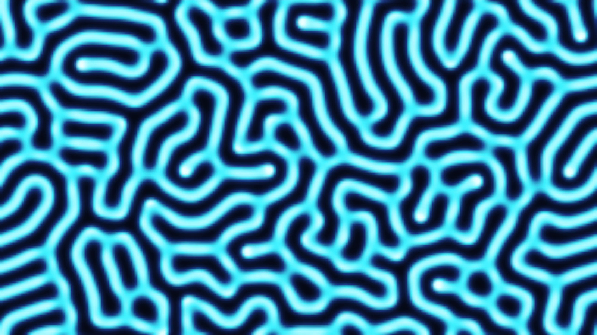
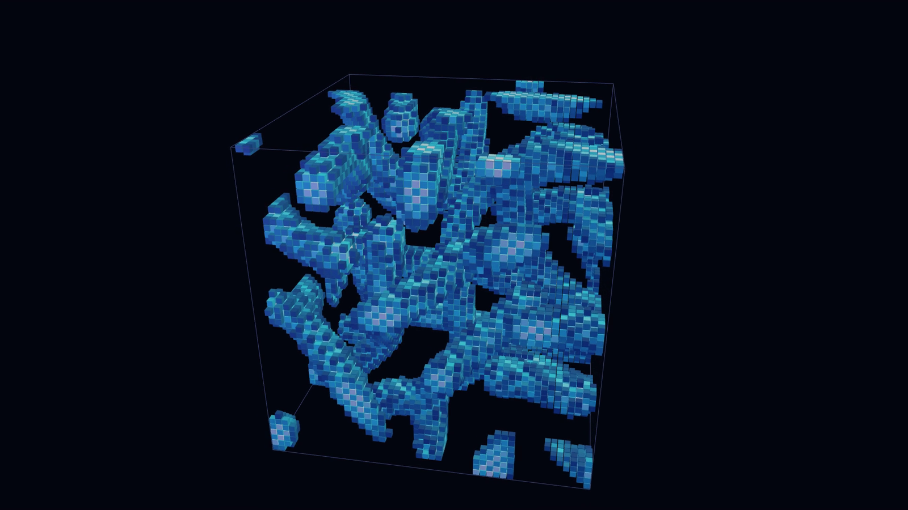

English | [日本語](README.md)

# Reaction-Diffusion — 2D / 3D

A sample that runs the reaction-diffusion model called the Gray-Scott model, with Three.js.\
Two substances only spread around and react, and patterns like spots, mazes and waves appear.\
The menu at the top switches between 2D and 3D.

- **Try it in your browser**
  - [lab.elekibear.com/en/demos/reaction-diffusion/](https://lab.elekibear.com/en/demos/reaction-diffusion/)

| | |
|---|---|
|  |  |
| **2D** — Maze-like patterns spreading | **3D** — A pattern growing inside a cube |

## Features

- **Basic behavior**
  - Switch between diffusion only, reaction only, and both
  - Pattern presets: coral, maze, dividing spots, waves, holes
- **Parameters**
  - Feed F, kill k and the diffusion rates
  - Grid size: 2D 192×108 to 512×288, 3D 32³ to 64³
  - Colors: choose from 3 sets

## Tech stack

- React 19
- TypeScript
- Vite
- Three.js
- Vitest
- Prettier

## Getting started

**Requirements**

- [Node.js](https://nodejs.org/) 22.12 or later

Run these commands in the repository folder.

```bash
npm install
npm run dev
```

Open the URL shown (usually `http://localhost:5173/`) in your browser.

Press "JA | EN" at the top right, or add `?lang=en` to the URL, to show English. End the URL with `#3d` to open the 3D screen.

## Folders

```
src/
  core/      Gray-Scott core logic. Read this first
  data/      Pattern presets
  view2d/    The 2D screen
  view3d/    The 3D screen
  ui/        Parts shared by 2D and 3D
  shared/    Keyboard, language and colors
tests/       Tests
```

## Where to read

The logic is in `src/core/`. It does not depend on any framework, so reading it shows how it works.

1. **[`src/core/grayScott2d.ts`](src/core/grayScott2d.ts)** — grid → Laplacian → one step (diffusion + reaction). The screens use `stepFast`, a faster version of the same equation
2. **[`src/core/reaction.ts`](src/core/reaction.ts)** — the reaction (U + 2V → 3V). It looks at one cell only, so 2D and 3D share it
3. **[`src/core/grayScott3d.ts`](src/core/grayScott3d.ts)** — the 3D version in the same order. Only the neighbors go from 4 to 6
4. **[`src/core/params.ts`](src/core/params.ts)** — diffusion rates, feed and kill
5. **[`src/data/presets.ts`](src/data/presets.ts)** — the pattern presets

This part moves one cell forward one step (u is the concentration of U, v is the concentration of V. U is a material added from outside, and V is a substance that uses U to grow).

```ts
if (terms.diffusion) {
  du += params.du * laplacian(field.u, field, x, y);  // spreads
  dv += params.dv * laplacian(field.v, field, x, y);
}
if (terms.reaction) {
  du += reactU(u, v, params);  // used by the reaction + fed
  dv += reactV(u, v, params);  // grown by the reaction − killed
}
next.u[i] = u + du * DT;
next.v[i] = v + dv * DT;
```

`laplacian` is "sum of the neighbors − the cell × the number of neighbors": a cell with less than its neighbors gains, a cell with more loses.\
V spreads slower than U, so V gathers into spots and U flows in around them.

## References

- John E. Pearson, "Complex Patterns in a Simple System", *Science* 261 (1993)
- Robert Munafo, "Reaction-Diffusion by the Gray-Scott Model: Pearson's Parametrization" (mrob.com)

## Docs

- [Code guide](docs/code_guide.md) (Japanese) — rules for changing the code
