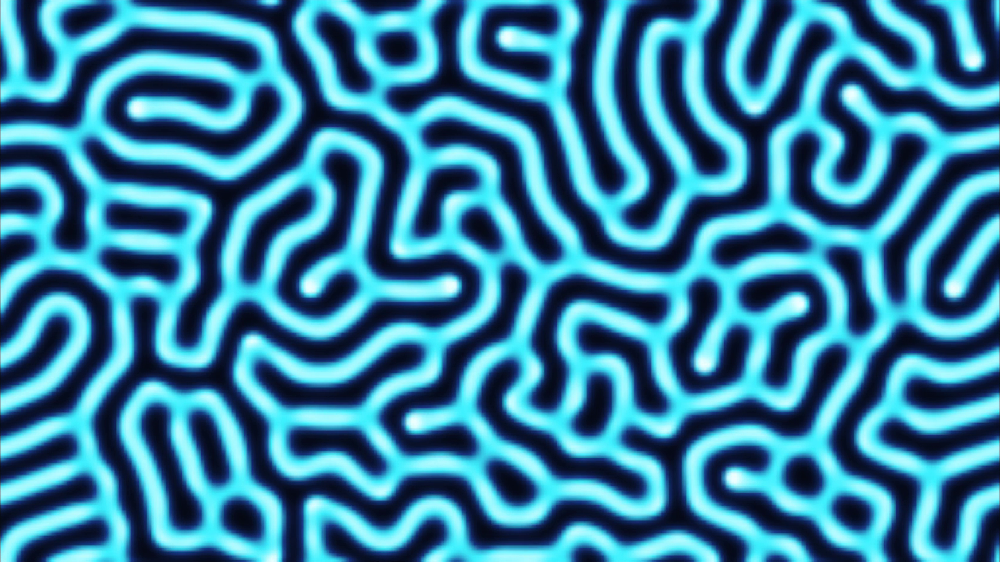
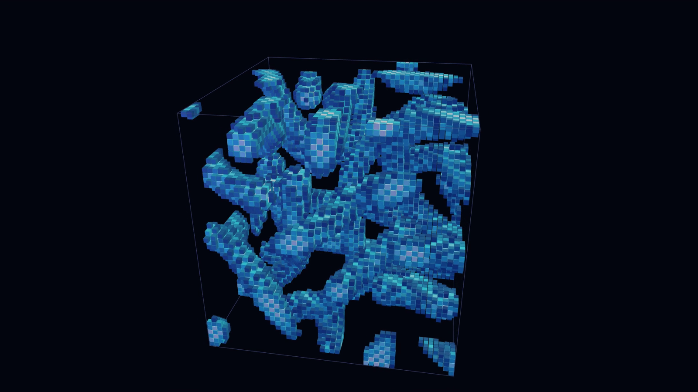

[English](README.en.md) | 日本語

# Reaction-Diffusion — 2D / 3D

反応拡散のモデル「Gray-Scott モデル」を Three.js で動かしたサンプルです。\
2 種類の物質が、まわりに広がりながら反応するだけで、斑点・迷路・波のような模様が生まれます。\
画面上部のメニューで 2D・3D を切り替えて遊べます。

- **ブラウザで触る**:
  - [lab.elekibear.com/demos/reaction-diffusion/](https://lab.elekibear.com/demos/reaction-diffusion/)

| | |
|---|---|
|  |  |
| **2D** — 迷路のように広がる模様 | **3D** — 立方体の中に育つ模様 |

## できること

- **基本の動き**
  - 拡散だけ・反応だけ・両方を切り替えられる
  - 模様のプリセット: サンゴ・迷路・分裂する斑点・波・穴
- **パラメータ**
  - 補充 F・除去 k・拡散の速さ
  - 盤面の大きさ: 2D は 192×108〜512×288、3D は 32³〜64³
  - 色: 3 種類から選べる

## 技術構成

- React 19
- TypeScript
- Vite
- Three.js
- Vitest
- Prettier

## 起動方法

**必要なもの**

- [Node.js](https://nodejs.org/) 22.12 以上

リポジトリのフォルダで、次のコマンドを実行します。

```bash
npm install
npm run dev
```

表示された URL（通常は `http://localhost:5173/`）をブラウザで開きます。

右上の「JA | EN」を押すか、URL に `?lang=en` を付けると英語で表示します。末尾を `#3d` にすると 3D の画面から開きます。

## フォルダ構成

```
src/
  core/      Gray-Scott のコアロジック。まずここを読む
  data/      模様のプリセット
  view2d/    2D の画面
  view3d/    3D の画面
  ui/        2D と 3D で共通の部品
  shared/    キーボード操作・言語・色
tests/       テストコード
```

## コードの読みどころ

ロジックは `src/core/` にまとまっています。フレームワークに依存しない処理なので、ここを読むと仕組みが分かります。

1. **[`src/core/grayScott2d.ts`](src/core/grayScott2d.ts)** — 盤面 → ラプラシアン → 1 ステップ（拡散 + 反応）。画面は同じ式の高速版 `stepFast` を使う
2. **[`src/core/reaction.ts`](src/core/reaction.ts)** — 反応（U + 2V → 3V）。1 マスだけを見るので 2D と 3D で共通
3. **[`src/core/grayScott3d.ts`](src/core/grayScott3d.ts)** — 同じ順に並べた 3D 版。隣りが 4 つから 6 つになるだけ
4. **[`src/core/params.ts`](src/core/params.ts)** — 拡散の速さ・補充・除去
5. **[`src/data/presets.ts`](src/data/presets.ts)** — 模様のプリセット

1 マスを 1 ステップ進めるのは、この部分です（u は U の濃さ、v は V の濃さ。U は外から足される材料で、V は U を使って増える物質）。

```ts
if (terms.diffusion) {
  du += params.du * laplacian(field.u, field, x, y);  // 広がる
  dv += params.dv * laplacian(field.v, field, x, y);
}
if (terms.reaction) {
  du += reactU(u, v, params);  // 反応で使われる + 補充される
  dv += reactV(u, v, params);  // 反応で増える − 除去される
}
next.u[i] = u + du * DT;
next.v[i] = v + dv * DT;
```

`laplacian` は「隣りのマスの合計 − 自分 × 隣りの数」で、隣りより少なければ増え、多ければ減ります。\
V は U より遅く広がるので、V は固まって斑点になり、そのまわりに U が流れ込みます。

## 参考

- John E. Pearson, "Complex Patterns in a Simple System", *Science* 261 (1993)
- Robert Munafo, "Reaction-Diffusion by the Gray-Scott Model: Pearson's Parametrization" (mrob.com)

## ドキュメント

- [コードガイド](docs/code_guide.md) — 手を入れるときの決まり
